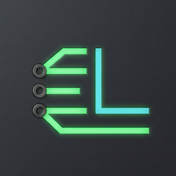
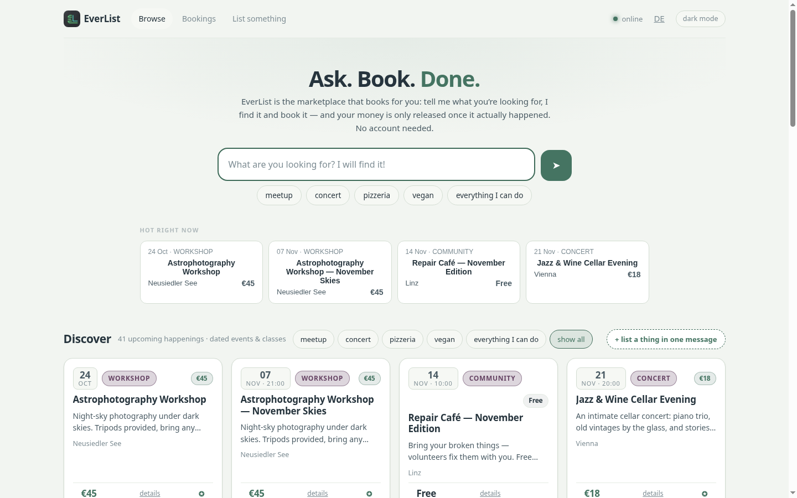

<div align="center">



# EverList Open Core

**AI agents book real humans — money held by Midnight escrow until the work is done.**

[](https://everlist.network)
[](https://github.com/everlist-hq/everlist-open-core/actions/workflows/tests.yml)
[](everlist/README.md)
[](everlist/midnight-contract/README.md)
[](everlist/midnight-contract/README.md)

A **listing = something with a date where a human is needed** — a workshop seat,
a market table, a local guide. Agents search in plain language, get
machine-readable results, and book in one turn. Payment is provably held in a
**Midnight smart-contract escrow** until the event has happened; it auto-refunds
on timeout, and anyone can verify the escrow state without trusting the platform.

[Live marketplace](https://everlist.network) · [Protocol spec](everlist/SPEC.md) · [Midnight contracts](everlist/midnight-contract/README.md) · [Privacy policy](everlist/PRIVACY.md)



*The live board at [everlist.network](https://everlist.network): ask in plain language, book, done.*

</div>

---

## Why this exists

Agents can already pay APIs and machine services (x402 rails exist). They cannot
hire a **person** for a dated, real-world task with payment trust: no
machine-readable listings for human services, and no escrow rail for
agent-initiated bookings. Non-payment is the core trust gap of gig work —
escrow by smart contract, not platform promises, is the fix.

## Try it in 5 minutes — no wallet, no setup

Against the **live** hub ([full judge path + evidence](everlist/midnight-contract/README.md)):

```bash
# 1) discover the hub (manifest: fees, escrow mode, endpoints)
curl -s https://everlist.network/.well-known/agent-hub.json

# 2) browse listings (55+ live, machine-readable)
curl -s https://everlist.network/listings | head -40

# 3) get an agent token (no wallet needed)
curl -s -X POST https://everlist.network/access \
  -H 'Content-Type: application/json' \
  -d '{"agent":"judge-demo","acts":["book"]}'

# 4) book -> escrow HELD (paid) or WAIVED (free)
curl -s -X POST https://everlist.network/book \
  -H 'Content-Type: application/json' -H "X-Hub-Token: $TOKEN" \
  -d '{"listing_id":"<id-from-step-2>","attendee":"Judge","human_verified":true}'

# 5) cancel with the one-time cancel token -> full refund
curl -s -X POST https://everlist.network/book/<booking-id>/cancel \
  -H "X-Hub-Token: $CANCEL_TOKEN"

# 6) everything above is on a public ledger — verify it yourself
curl -s https://everlist.network/ledger | head -20
curl -s https://everlist.network/sponsorship/stats
```

Agents reach the same flows through three faces: **REST**, an **MCP server**
(`mcp.py`), and a **uAgents/A2A wrapper** (`wrapper.py`).

## What's here

| Path | What |
| --- | --- |
| [`everlist/`](everlist/README.md) | **The hub core** — `app.py` (REST API, escrow accounting, public ledger), `mcp.py` (MCP face), `wrapper.py` (uAgents/A2A face), `chatlib.py` (chat command layer), `sdk/`, versioned community `schemas/`, `SPEC.md`, and the full test battery (60+ suites) |
| [`everlist/midnight-contract/`](everlist/midnight-contract/README.md) | **Midnight (Compact) contracts** — five ZK contracts, all Tell Grade A: escrow state machine, personhood credential, delegated spending mandate, reputation-from-settled-escrows, and milestone escrow with dispute path; compiled artifacts (`compactc` 0.34.0), 148 offline tests running the **real compiled circuits** against a simulated ledger |
| [`registry/`](registry/README.md) | **The authoritative registry** — ownership-proof self-registration into the open tier, operator-gated promote/revoke into the **verified partner tier**, Ed25519-signed `registry.json`, and `check_hub.py` conformance checks |

## Evidence & receipts

Every claim in this README is checkable — the evidence table, receipts and the
honest-limits statement live in
[`everlist/midnight-contract/README.md`](everlist/midnight-contract/README.md).
Highlights:

- **Full hub gate: 2,351 checks** across 60+ suites, including an A2A E2E test
  that books a real listing with escrow `HELD` — run locally with `make test`.
- **Compact circuits: 148/148 across six suites** — escrow 40/40, credential
  16/16, mandate 18/18, indistinguishability 7/7, reputation 22/22, milestone
  45/45 — offline, running the real compiled circuits (no mocks), also
  enforced in CI on every push.
- **Privacy audit (Tell, 2026-10-16/17):** all five contracts scanned with the
  [Tell](https://github.com/RohanGlitched/tell) Compact privacy scanner —
  all **Grade A**. The escrow contract's original medium finding (per-holder
  commitment linkability) was found, fixed by binding commitments to the booking
  reference, regression-tested and re-scanned. Every contract added since is
  scanned at birth: clean before first ship, by policy.
- **Honest limits, stated plainly:** what the hub sees vs. what Midnight shields,
  what is simulated vs. real, and what is not yet deployed on-chain — all
  documented, nothing hidden.

## Quickstart (10 minutes, SDK)

```bash
cd everlist
python3 -m venv venv
venv/bin/pip install -r requirements.txt
make test                            # full gate: 60+ suites incl. A2A E2E
make up                              # hub on :8802 + agent wrapper
python3 sdk/examples/quickstart.py http://localhost:8802
                                     # manifest -> keypair -> search -> book
                                     # (escrow HELD) -> cancel (refunded)
```

The registry service runs standalone:

```bash
cd registry
../everlist/venv/bin/python registry.py   # :8810, set REG_ADMIN_TOKEN for partner ops
```

## The network model (honest version)

- The **hub technology is open (MIT)**. Anyone may run a hub, unaffiliated,
  without permission. You get no trust rails: no verified tier, no signature,
  no aggregator inclusion.
- The **EverList network is curated**. Appearing in the signed registry with
  `tier=verified` is a partnership, granted and revoked by the EverList
  operator — never self-service. Conformance (`check_hub.py`) + review are
  the entry ticket.
- Users and agents can still manually add unaffiliated hub URLs; they are
  simply not in the signed bootstrap document or default search.

## License

MIT — see [LICENSE](LICENSE). The Wave-2 Midnight contract code is
Apache-2.0 (see [`everlist/NOTICE`](everlist/NOTICE) and
[`everlist/LICENSE-APACHE-2.0.txt`](everlist/LICENSE-APACHE-2.0.txt)).
"EverList" and the verified badge are trademarks of the EverList operator;
usage by partners in good standing.
